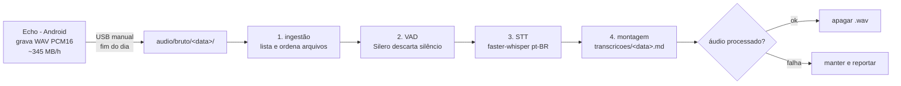

# 01 — Arquitetura

## Fluxo completo



## Componentes

### 1. Captura (celular)
App **Echo** (GPL-3.0, F-Droid), foreground service de microfone. Detalhes: [02-captura-audio.md](02-captura-audio.md).

### 2. Transferência
Manual, via cabo USB no fim do dia (MTP ou `adb pull`). Estrutura proposta no PC:

```
taquify/
├── audio/bruto/2026-10-14/      ← .wav do dia (transitório, git-ignored)
└── transcricoes/2026-10-14.md   ← saída permanente
```

### 3. Pipeline de transcrição (PC)
Ver [03-transcricao.md](03-transcricao.md). Resumo: ingestão → VAD → faster-whisper → `.md` → apaga áudio.

### 4. Geração e anotações
Fora do escopo atual — ver [ADR-0003](adr/0003-escopo-ate-o-md.md).

## Contrato do `.md` de saída

Este formato é a fronteira entre a fase atual e as futuras — precisa ser estável:

```markdown
---
date: 2026-10-14
duration: 09:12:33
model: whisper-small-int8
vad: silero
source: audio/bruto/2026-10-14
generated_at: 2026-10-14T22:10:00-03:00
---

## 08:12

texto do trecho transcrito...

## 08:19

texto do próximo trecho...
```

**Regras:**
- `frontmatter` YAML com metadados (chaves em inglês, por portabilidade).
- Seções `## HH:MM` = início do trecho (hora local) — preserva a linha do tempo do dia.
- Um arquivo por dia de gravação; gravação que cruzar a meia-noite é dividida na fronteira.
- Conteúdo é texto bruto do que foi falado, sem edição — a edição é papel da fase futura de geração.

## Por que local e por que agora

- **Grátis e eficiente:** sem custo por hora de áudio (APIs de nuvem custam de US$ 0,04 a 0,46 por hora de áudio — ver [speechtotext.dev/pricing](https://speechtotext.dev/pricing/)).
- **Privacidade:** o dia inteiro de conversas nunca sai da sua máquina.
- **Sem dependência de rede:** funciona offline, sem rate limit.
